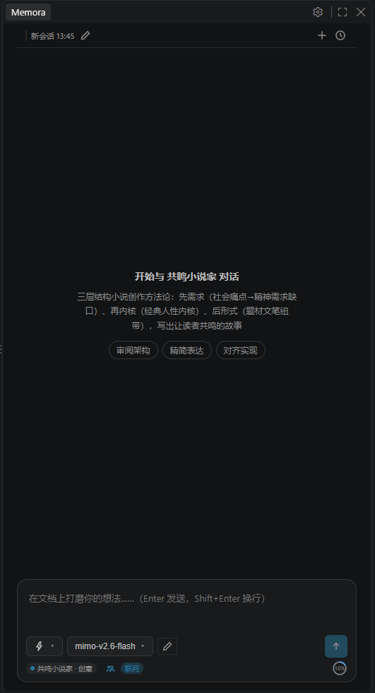
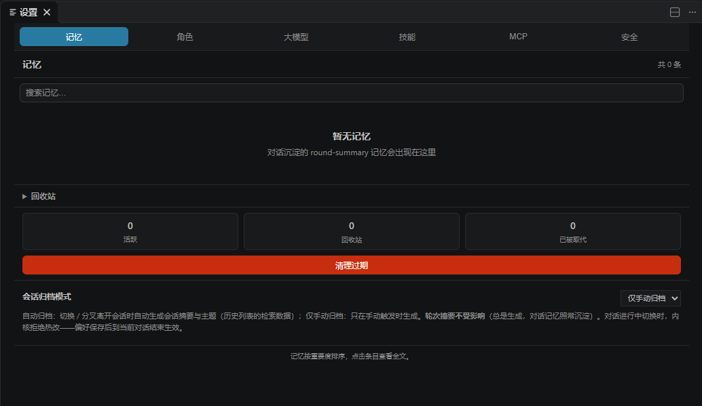
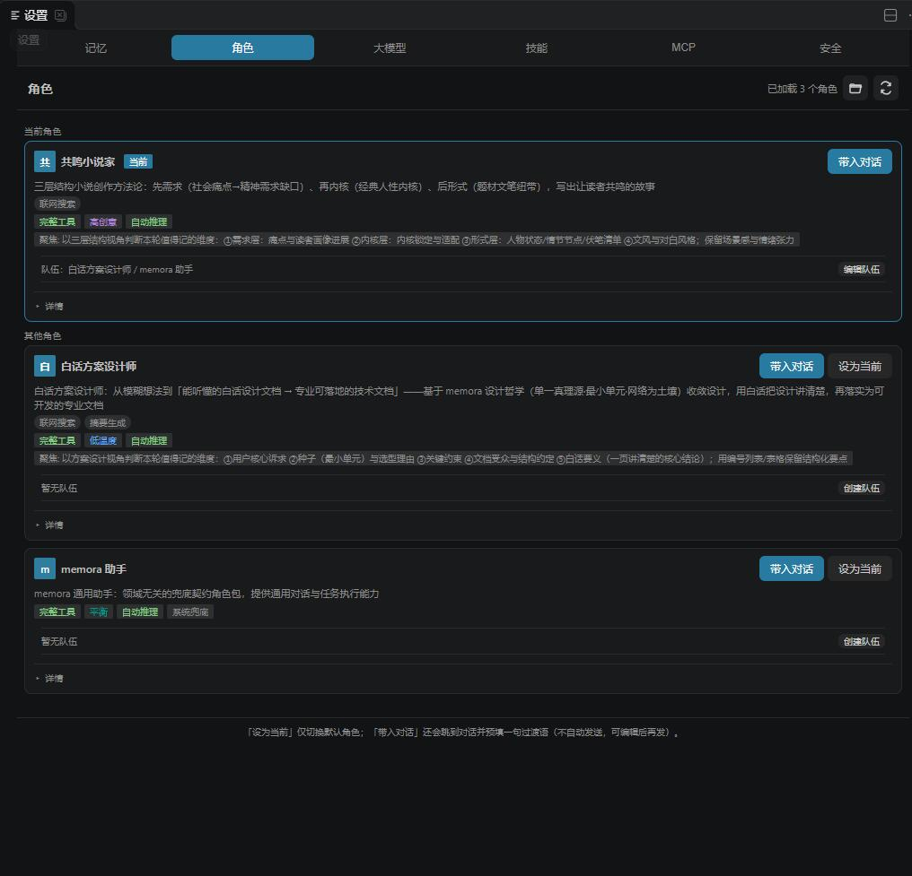
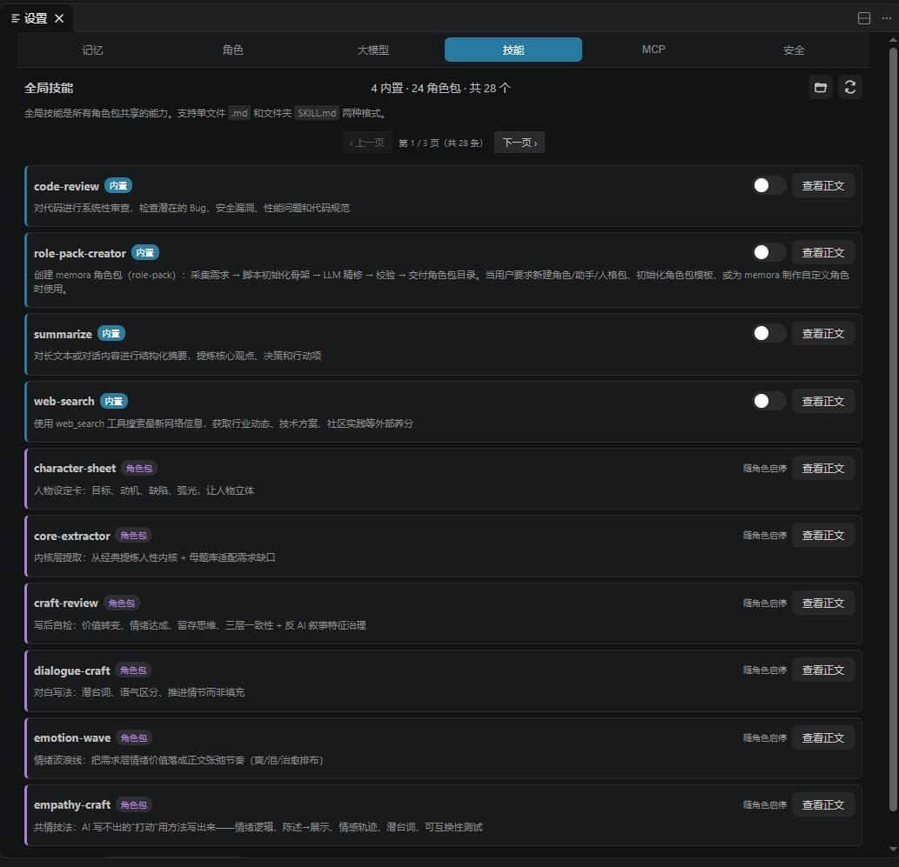

# Memora

Polish your design with AI, accumulate memory, generate skeletons — inside your IDE sidebar, so you stop churning through scattered code edits until everything is a mess.

**English** | [中文](./README.zh-cn.md)

Memora is a kernel-driven **VS Code AI assistant**: a thin shell that assembles the kernel and reuses all of its capabilities. What the assistant *is* comes from **built-in role packs** (it ships with `memora助手` — the fallback contract pack, `只读项目顾问` — a read-only advisor that never modifies your project files, `白话方案设计师` — a plain-language solution designer, and `共鸣小说家` — a resonant novelist). The extension itself hard-codes no positioning.

**Open source**: [github.com/zooique/memora](https://github.com/zooique/memora)

**Kernel**: built on the npm package [@zooique/memora](https://www.npmjs.com/package/@zooique/memora) `7.0.0` (the kernel generation bundled into this version, reconciled with every host release)

---

## Features

- **General chat**: open the sidebar and talk — positioning is decided by the active role pack
- **Cross-session memory**: remembers the decisions you settled earlier; in a new session the model can call `search_memories` itself to bring them back
- **Proactive questions**: at key moments the AI stops and asks you, instead of quietly building on a wrong assumption
- **Role-pack grounding (four built-in packs)**:
  - `memora助手` — domain-agnostic fallback contract pack; the default role for new sessions
  - `只读项目顾问` — reads, searches and analyses your project, then tells you what to improve and why. Its tool set is **read-only**: it never edits your project files (asking questions and pausing are session state, not project files, so they are not restricted)
  - `白话方案设计师` — converges a vague idea into a plain-language design doc, then into a developer-ready spec (includes a single-source-of-truth consistency review)
  - `共鸣小说家` — three-layer fiction workflow (need → core → form)
  - Switch packs, or set the default for new sessions, in **Settings › Roles** (or via `memora.defaultRolePack`)
- **File-change confirmation**: AI edits land in a staging area first; confirm or revert with one click at the top of the editor — nothing is written to disk silently
- **Web search**: the agent can look things up online — auto (default Bing→DuckDuckGo chain) / Bing / DuckDuckGo / Baidu / Sogou presets, plus custom engines (OpenSearch RSS / JSON API, connectivity is tested before saving)
- **MCP tools**: connect external MCP tool servers (user-level config; it only launches local subprocesses you trust). Their tools appear in the model's tool list as `mcp__<server>__<tool>`; every call asks for confirmation by default, and you can whitelist individual tools (an audit record is still written). Config changes take effect immediately — see [MCP tools setup](docs/mcp-setup.md)
- **Multiple models**: add several model APIs, switch anytime, with connection tests
- **Context references**: type `@` in the input box to pick files, or right-click to attach a reference (selections carry line numbers). References are pointers only and cost no budget; the current file, workspace diagnostics and uncommitted git changes can be injected in one click — see [Giving the AI context](#giving-the-ai-context-references-and-injection)
- **Image input (multimodal)**: send images right inside the conversation — paste into the input box, click the "upload image" button there, right-click a real image in the explorer / editor → "Memora: Add to Chat", or drag one in from the file system (external files need `Shift` held). All four entry points converge on the same ingestion pipeline; when the model does not declare vision support, the entry point tells you up front and the first gate rejects with an explicit reason — your image is never dropped silently. Past images are restored with the turn
- **One-click reset**: Settings › Security can clear all user-level data (model config and API keys, user skills and role packs, security switches, …) and restore the first-run state; the current project's memory and sessions are untouched

## Screenshots

**Chat panel** (gear in the title bar goes straight to settings, role badge, model switcher, quick actions all on one screen):



**Settings › Memory** (memory retrieval, plus Roles / Models / Skills / Security tabs, trash and expiry cleanup):



**Settings › Roles** (role-pack management: switch and set current, full tool / temperature badges, team orchestration):



**Settings › Skills** (global skills and role-pack skills side by side: built-in marker, enable/disable toggle, view content):



## Installation

### Option 1: from the Marketplace

Open the Extensions view (`Ctrl+Shift+X`), search for **Memora**, click Install.

### Option 2: from a VSIX (offline package)

1. Get the `memora-vscode.vsix` file
2. Open the Extensions view (`Ctrl+Shift+X`)
3. Click `...` in the top right → **Install from VSIX...**
4. Pick `memora-vscode.vsix` and wait for it to finish
5. Reload the window (`Ctrl+Shift+P` → `Reload Window`)

## Quick start

1. Click the **Memora** icon in the activity bar on the left
2. On first use, open the Settings panel to configure a model (click the gear ⚙ in the Chat view title bar, or `Ctrl+Shift+P` → `Memora: Open Settings Panel`, or click "Configure model" in the empty chat state):
   - Click "Add API" → fill in alias / model / base URL / API key
   - Click "Test connection" to verify → Save → "Set as current"
   - Add several and switch between them at any time
3. Open the **Chat** panel and start talking (the badge next to the title shows the active role pack — `memora助手` by default; switch packs in **Settings › Roles**)
   - With `白话方案设计师` active: "please review this document for self-consistency" or "please draft the technical spec from this design doc"
   - With `共鸣小说家` active: "help me turn this premise into a story"

### Local models (Ollama / LM Studio)

Memora works with any local runtime that speaks the OpenAI protocol (Ollama, LM Studio, …) — point the base URL at your local address and no internet connection is needed:

1. Start the local service (pick one):
   - **Ollama**: run `ollama serve` → set the base URL to `http://localhost:11434/v1` and the model to a name you have pulled (e.g. `qwen3`); the API key can be any placeholder (local runtimes usually do not authenticate)
   - **LM Studio**: enable the OpenAI-compatible server in the developer panel → set the base URL to `http://localhost:1234/v1`
2. When adding the model under "Model configuration", set "Source type" to **local runtime**:
   - **Supports native tool calling (OpenAI function calling)**: checked by default. Checked means the local model can call tools (web search / file read-write / memory retrieval, …); unchecked means plain-text chat only — the tool channel is collapsed and the model is told tools are unavailable
   - Cloud models (the default) need no attention here: cloud providers enable native tool calling by default, exactly as in previous versions

> Tip: whether a local model supports native tool calling cannot be inferred from its address — you have to check it according to what the model actually does. Most recent models (e.g. the qwen2.5 / qwen3 / llama3.x families) do support it.

### Skip the settings panel (environment variables)

The extension falls back to environment variables; **restart VS Code** after setting them:

```bash
set MEMORA_BASE_URL=https://api.xiaomimimo.com/v1
set MEMORA_MODEL=deepseek-chat
set MEMORA_API_KEY=your-key
```

If you already have environment variables configured, you can skip the settings panel entirely. Priority: **activated provider in the settings panel > environment variables**.

## Giving the AI context (references and injection)

Above the text in the input box sit two rows of small chips: the top row is skills, the bottom row is **context** — the current file, `@` injections and the references you attached all live there. Context comes in two kinds: **references** (pointer only, no budget) and **injection** (full text, consumes budget).

### Three ways to attach a reference

| Way | Action | Result |
|------|--------|--------|
| Type `@` in the input box | A workspace file picker pops up (fuzzy search, multi-select) | Selecting a file attaches a reference chip, the `@` character is removed, focus returns to the input box |
| Editor right-click → **Memora: Add to Chat** | For the currently open file | Attaches a file reference; **with a selection it carries line numbers** (e.g. `#L5-L24`), so the AI reads only the part you selected |
| Explorer right-click → **Memora: Add to Chat** | For a file / folder | Attaches a file or folder reference (a folder gives only a map; the AI reads contents on demand) |

### A reference is a pointer, not content

A reference only tells the AI "go look at this file" — it does **not** stuff the body into the conversation. Hovering a chip shows "pointer only, the body is read on demand (no budget)". What actually consumes budget is **injection**, below.

### Chip row operations

- **Click a chip** (path or line numbers): open and locate it in the editor; with line numbers the range is highlighted — no need to count lines yourself to check "which lines did I actually reference"
- **🔒 Pinned**: kept after sending (unpinned chips are cleared on send)
- **✕**: remove a single chip
- **Clear all references**: the button at the end of the chip row clears every reference at once (pinned ones included)
- The chip row **never wraps**: many chips scroll horizontally, with fading hints on both sides showing there is more

### Broken references are called out

If an attached file is deleted or renamed, that reference is degraded to a bare pointer and marked "no longer exists after attaching" when you send — the AI asks you first instead of hitting an error with a dead path.

### The current-file chip: attached automatically, can be turned off for this session

The first chip on the context row shows the file currently open:

- **Clean file**: pointer only (`📄 plain-language-design.md`), no budget
- **Unsaved / untitled / outside the workspace**: shows "full text attached" — the disk is not the truth, so the editor buffer is what gets injected
- **✕**: stop attaching it for this session (it becomes a dashed capsule "current file not attached · click to enable"; one click brings it back, no dead ends)

### `@` injection contexts: diagnostics and uncommitted git changes

The top of the `@` list has two keyword entries:

- **Diagnostics (Problems panel)**: injects the workspace's errors / warnings
- **Uncommitted git changes**: injects `git status` + `git diff` (read-only collection, bounded: at most 20 files / 200 lines per file / 12K characters total, with explicit truncation notices)

Three differences from references: contents are **fetched at send time** (attaching only marks the channel); they **consume budget**; and their chips have no 🔒 and are **cleared automatically after sending** (pinning a snapshot = feeding stale data next turn).

### Where this turn spent its budget: injection attribution

After sending a message, hover the context-usage ring — the card footer shows "injected N this turn (breakdown …)", telling you per source where the budget went (e.g. "current file body 3,258 · workspace diagnostics 120"). A clean file never shows a number (by design it is not injected); to verify injection volume, edit without saving and send a message.

> Injection happens **only at send time**, and the live projection carries no numbers — not previewing an estimate while you type is intentional; the next keystroke would invalidate it anyway.

## Commands

| Command | Description |
|---------|-------------|
| `Memora: Open Chat Panel` | Open the sidebar chat panel (positioning comes from the role pack), shortcut `Ctrl+Alt+M` |
| `Memora: Configure Model` | Open the model configuration panel |
| `Memora: Manage Role Packs` | Open the Roles tab of settings (the "current role" badge in the chat area lands here too) |
| `Memora: View Memory Statistics` | Show the current project's memory count and storage overview |
| `Memora: Clean Up Expired Memories` | Clean up memories past their retention period |
| `Memora: Run Orphan Garbage Collection Now` | GC: reclaim orphaned memories no session references anymore |
| `Memora: Reset to Initial State (Clear User-Level Data)` | Clear all user-level data in one click (model config and API keys, user skills and role packs, security switches, …) and restore the first-run state; project memory and sessions are kept; the window reloads automatically when done |
| `Memora: Run Capability Demo (Isolated Demo Area)` | Run the capability demo in an isolated demo area without touching real data |
| `Memora: Reload Skills and Role Packs` | Rescan built-in and user skills and role packs |
| `Memora: Import Skill or Role Pack (.zip)` | Import a skill or role pack from a zip (reload afterwards if needed) |
| `Memora: Open Settings Panel` | Open the settings panel (models / search / archiving / MCP / security / works and rules — all preferences and lists in one place) |
| `Memora: Register Work Projection` | Register the current file as a work projection that can accumulate (explorer and editor context menus); once registered it shows up under **Settings → "Works and rules"** |
| `Memora: Toggle Project Rule` | Toggle the "project rule" resident state of a right-clicked file (its body is injected every turn). If the file is not registered it only tells you to register first — it **never creates** a registration; the current state is reported in the receipt |
| `Memora: Manage Project Rules` | Open a temporary QuickPick list to toggle / unregister entries one by one (the list-management surface) |
| **Settings → "Works and rules" page** | The browsing surface for work projections: each card shows the work name, one-line summary, source path and whether it is a project rule; click **"Set as project rule"** in the row to promote the work into a red line injected automatically every turn. There is also a badge for whether the most recent assembly actually injected it (read failure / single item over limit / total over limit each have their own mark). **Clicking a row opens the source file**, so you can edit it directly and the next assembly re-reads it after saving; two in-row buttons toggle the rule / unregister only (the source file is never deleted). The refresh button re-reads the list; **the badge reflects the most recent assembly**: list edits show up immediately, while failure reasons are recomputed on the next conversation turn |
| `Memora: Add to Chat` | Add a file / folder from the explorer, or an editor selection, to the chat input as a reference (pointer only, no content injected) |
| `Memora: Add Image to Chat` | Open a file picker to add a local image to the chat input (converges with paste / right-click / drag onto the same ingestion pipeline) |
| `Memora: Review File Changes` | Review the file changes the AI produced this turn |
| `Memora: Confirm All File Changes` | Confirm every change of this turn in one click |
| `Memora: Revert All File Changes` | Revert every change of this turn in one click |
| `Memora: Confirm Changes in This File` | Editor title-bar button: confirm the staged changes of the current file |
| `Memora: Revert Changes in This File` | Editor title-bar button: revert the staged changes of the current file |
| `Memora: Copy Diagnostic Summary` | Copy version / environment / config / recent webview errors / runtime metrics in one click — paste it to the maintainer when reporting a problem |

## Data storage

Extension data comes in two levels — **project level and user level**. The extension defines the behaviour, everything uses VS Code's native mechanisms, and no extra user folder is created:

| Level | Location | Content |
|-------|----------|---------|
| Project | workspace `.memora/` directory | session records `sessions.json` / memories `memories.json` |
| User | VS Code user settings `settings.json` | model provider config (alias / model / base URL, **no API keys**) |
| User | VS Code user settings `settings.json` | search preferences: `memora.searchEngine` (a preset or a custom engine name) and `memora.customSearchEngines` (custom list, `application` scope = shared across projects) |
| User | VS Code user settings `settings.json` | AI answer language: `memora.answerLanguage` (empty or `auto` = follow VS Code's display language; you can also type a language name such as `Japanese`. **Only affects the answer language, never the UI text**; takes effect from the next reply) |
| User | VS Code user settings `settings.json` | MCP config: `memora.mcpServers` (external tool servers) and `memora.mcpToolAllowlist` (confirmation-free whitelist; user-level = shared across projects, **workspace level is not accepted** — see [mcp-setup.md](docs/mcp-setup.md)) |
| User | VS Code global storage `globalStorage` | active role pack (shared across projects) |
| User | VS Code SecretStorage | API keys (encrypted at rest) |

Notes:

- **Project-level `.memora/`**: one memory set per project, travelling with the workspace (commit it or ignore it, your call).
- **User-level config** lives in the VS Code user data directory (Windows: `AppData/Roaming/Code/User/`). Provider config is user-level rather than project-level so it is shared across projects — no reconfiguration when you switch projects, and no pollution of the project's `.vscode/settings.json`.
- **API keys go to SecretStorage** (VS Code's encrypted storage): they are never written to settings.json and never enter git. **Not finding a plaintext file is the intended security design** — keys should not be on disk in plaintext in the first place.
- **Reset to initial state**: the Security tab of the settings panel, or `Memora: Reset to Initial State` in the command palette, clears every user-level store in the table above in one click; project-level `.memora/` and project settings are unaffected.
- If an older version wrote provider config into the project's `.vscode/settings.json`, the extension migrates it to user level and cleans up the leftovers on startup.

## Troubleshooting

### Chat reports 401 / authentication failure?

Read the wording of the error first — three shapes, three fixes:

| Message shape | Meaning | What to do |
|---------------|---------|------------|
| `API Key "xxx" is not stored: …` | The provider is configured, but the system keychain has **no** key for it | Edit that provider under **Settings › Models** and fill in the API Key |
| `API Key for "xxx" read failed: …` | The keychain itself cannot be read (state unknown — not necessarily a missing key) | Follow the reason in the message, then restart VS Code and retry |
| `API Key for "xxx" read timed out: …` | The keychain did not respond within 5 seconds | Restart VS Code; if it keeps happening, check the system credential service (Windows Credential Manager) |

Where a missing key usually comes from (most common first):

1. **Settings Sync** (the most common): VS Code's Settings Sync syncs settings.json but **not** the system keychain — on a new machine the provider list is complete while all keys are gone. Filling them in once fixes it.
2. **The key was not written when saving**: the save receipt already warned "provider config saved, but the API key failed" — the provider is in the list, the key never reached the keychain. Edit that provider and fill in the key; no need to re-enter everything.
3. **Reset to initial state failed midway**: clearing user data has two steps (delete keys first, then clear config); a failure in between leaves the intermediate state "provider registered, key deleted". Filling in that provider fixes it.
4. **System credentials were cleaned up**: security software or a cleanup tool touched the system credential store. Fill the key in again and watch whether it recurs.

### It says "this provider is temporarily unavailable"?

That is a half-finished state: config saved, key not saved, **and the form contents are still there** — close the form, edit the provider in the provider list and fill in the API key; no need to start over.

### Still need to report a problem

Run `Memora: Copy Diagnostic Summary` from the command palette to copy version / environment / config / recent webview errors / runtime metrics in one click, then paste it to the maintainer.

---

**License**: MIT
