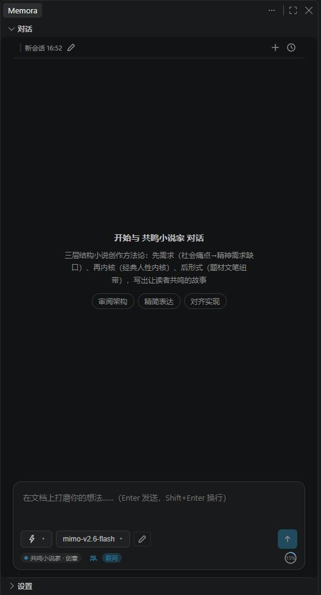
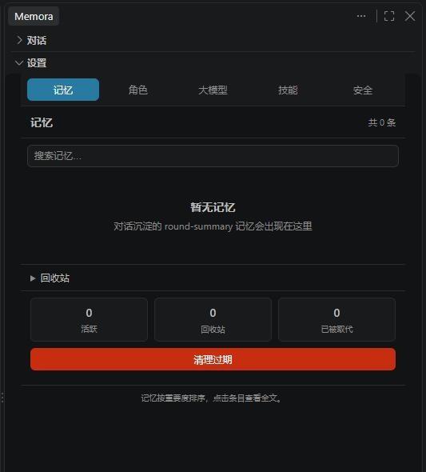
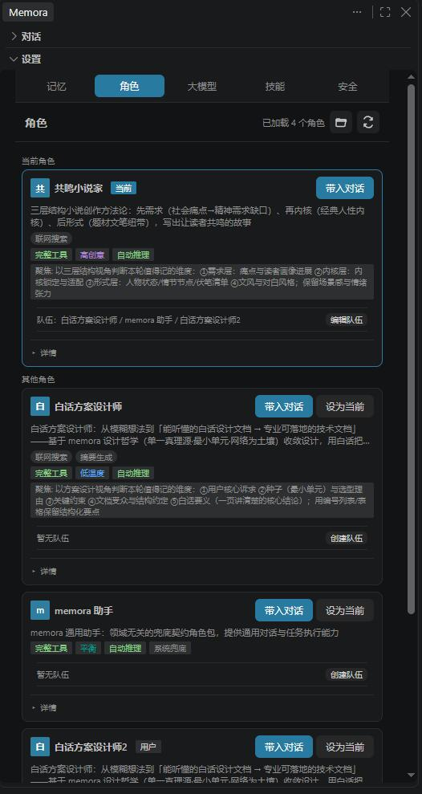

# Memora

用 AI 打磨设计、沉淀记忆、生成骨架——在 IDE 侧边栏里做，消灭"反复拉扯代码导致一团乱"。

Memora 是内核驱动的 **VS Code AI 助手**：薄壳装配、复用内核全部能力，功能定位由**内置角色包**承载（出厂自带「文档打磨」角色），插件本身不硬编码任何定位。

**开源仓库**：[github.com/zooique/memora](https://github.com/zooique/memora)

**内核**：基于 npm 包 [@zooique/memora](https://www.npmjs.com/package/@zooique/memora) `4.0.0` 开发（本版本内联的内核代次，随宿主版本发布核对）

---

## 功能

- **通用对话**：打开侧边栏与 AI 对话，定位由角色包决定
- **跨会话记忆**：记得你之前定过的决策，新会话中 LLM 可自行调用 `search_memories` 取回
- **主动提问**：关键节点 AI 会停下来问你，不闷头写偏
- **角色包定位（出厂自带 doc-review）**：
  - **文档自洽检查**：在对话中让 AI 审阅文档的矛盾 / 缺口 / 悬空引用
  - **代码骨架生成**：自洽通过后，根据设计文档让 AI 生成代码骨架
- **文件改动确认**：AI 改文件先进暂存，编辑器顶部一键确认 / 回退，不静默落盘
- **网络搜索**：Agent 可联网查资料——auto（默认链 Bing→DuckDuckGo）/ Bing / DuckDuckGo / 百度 / 搜狗 五档预设可选，另可自定义搜索引擎（OpenSearch RSS / JSON API，保存前实测验证连通）
- **多模型配置**：可添加多个大模型 API，随时切换，支持连接测试
- **一键初始化**：设置 › 安全里一键清空用户级数据（大模型配置与 API Key、用户技能与角色包、安全开关等），恢复首次使用状态；当前项目的记忆与会话不受影响

## 界面预览

**对话面板**（角色徽章、模型切换、快捷动作一屏可达）：



**设置 · 记忆**（记忆检索、角色 / 大模型 / 技能 / 安全分页，回收站与过期清理）：



**设置 · 角色**（角色包管理：多角色切换与设为当前、完整工具 / 温度徽章、团队编排）：



## 安装

### 方式一：从市场安装

打开扩展面板（`Ctrl+Shift+X`），搜索 **Memora**，点击安装。

### 方式二：从 VSIX 安装（离线包）

1. 拿到 `memora-vscode.vsix` 文件
2. 打开扩展面板（`Ctrl+Shift+X`）
3. 点右上角 `...` → **从 VSIX 安装...**（Install from VSIX...）
4. 选择 `memora-vscode.vsix`，等待安装完成
5. 重载窗口（`Ctrl+Shift+P` → `Reload Window`）

## 快速上手

1. 点击左侧活动栏的 **Memora** 图标
2. 首次使用，先到「设置」面板配置大模型：
   - 点「添加 API」→ 填别名 / 模型 / Base URL / API Key
   - 点「测试连接」验证 → 保存 → 「设为当前」
   - 支持添加多个，随时切换
3. 打开「对话」面板，开始对话（标题旁徽章显示当前角色 `doc-review`）
   - 说"请对当前文档做自洽性审阅" → 触发自洽检查
   - 说"请基于设计文档生成代码骨架" → 触发骨架生成

### 本地模型（Ollama / LM Studio）

Memora 兼容任何 OpenAI 协议的本地运行时（Ollama、LM Studio 等），把请求发到本地地址即可，无需联网：

1. 本地启动服务（选择其一）：
   - **Ollama**：`ollama serve` → Base URL 填 `http://localhost:11434/v1`，模型填已拉取的模型名（如 `qwen3`），API Key 可留任意占位（本地一般不做鉴权）
   - **LM Studio**：开发者面板启用 OpenAI 兼容服务器，Base URL 填 `http://localhost:1234/v1`
2. 在「大模型配置」添加时，把「来源类型」选为 **本地运行时**：
   - **支持原生工具调用（OpenAI Function Calling）**：默认勾选。勾选表示本地模型能调用工具（联网搜索 / 文件读写 / 记忆检索等）；取消勾选则仅纯文本对话，工具通道自动收起并告知模型不可用
   - 云端模型（默认）无需操心此项——云端服务商默认启用原生工具调用，行为与历史版本完全一致

> 提示：本地模型是否支持原生工具调用无法从地址自动推断，需要你按模型实际能力显式勾选。多数近期模型（如 qwen2.5 / qwen3 / llama3.x 系列）都支持。

### 不用配置面板（环境变量方式）

插件回退读取环境变量，设好后**重启 VS Code** 生效：

```bash
set MEMORA_BASE_URL=https://api.xiaomimimo.com/v1
set MEMORA_MODEL=deepseek-chat
set MEMORA_API_KEY=你的key
```

已有环境变量配置的，无需走配置面板，优先级：**配置面板激活 Provider > 环境变量**。

## 命令

| 命令 | 说明 |
|------|------|
| `Memora: 打开对话面板` | 打开侧边栏对话面板（角色包承载定位），快捷键 `Ctrl+Alt+M` |
| `Memora: 配置大模型` | 打开大模型配置面板 |
| `Memora: 管理角色包` | 打开角色管理选项卡（对话区「当前角色」徽章点击同此落点） |
| `Memora: 查看记忆统计` | 查看当前项目的记忆条数与存储概况 |
| `Memora: 清理过期记忆` | 清理超过保留期的记忆 |
| `Memora: 立即执行孤儿回收` | GC：回收不再被会话引用的孤立记忆 |
| `Memora: 恢复初始状态（清空用户级数据）` | 一键清空用户级数据（大模型配置与 API Key、用户技能与角色包、安全开关等），恢复首装态；项目记忆与会话保留，完成后自动重载窗口 |
| `Memora: 运行能力演示（隔离演示区）` | 在隔离演示区跑一遍能力演示，不动真实数据 |
| `Memora: 重载技能与角色包` | 重新扫描内置与用户技能、角色包 |
| `Memora: 登记作品投影` | 把当前文件 / 选区登记为可沉淀的作品投影（资源管理器与编辑器右键菜单） |
| `Memora: 查看文件改动` | 查看 AI 本轮产生的文件改动清单 |
| `Memora: 全部确认文件改动` | 一次性确认本轮全部改动 |
| `Memora: 全部回退文件改动` | 一次性回退本轮全部改动 |
| `Memora: 确认本文件改动` | 编辑器顶部按钮，确认当前文件的暂存改动 |
| `Memora: 回退本文件改动` | 编辑器顶部按钮，回退当前文件的暂存改动 |

## 数据存储

插件数据分**项目级 / 用户级**两级存储（插件定义行为，全部走 VS Code 原生机制，不额外创建用户目录文件夹）：

| 层级 | 位置 | 内容 |
|------|------|------|
| 项目级 | 工作区 `.memora/` 目录 | 会话记录 `sessions.json` / 记忆 `memories.json` |
| 用户级 | VS Code 用户设置 `settings.json` | 大模型 Provider 配置（别名 / 模型 / Base URL，**不含 API Key**） |
| 用户级 | VS Code 用户设置 `settings.json` | 搜索引擎偏好：`memora.searchEngine`（预设或自定义引擎名）与 `memora.customSearchEngines`（自定义清单，`application` 作用域 = 跨项目共享） |
| 用户级 | VS Code 全局存储 `globalStorage` | 激活角色包（跨项目共享） |
| 用户级 | VS Code 安全存储 `SecretStorage` | API Key（加密存储） |

补充说明：

- **项目级 `.memora/`**：一个项目一份记忆，随项目工作区走（可提交或忽略由你决定）。
- **用户级配置**在 VS Code 用户数据目录（Windows：`AppData/Roaming/Code/User/`）。Provider 配置存用户级而非项目级——跨项目共享，切换项目无需重配，且不污染项目 `.vscode/settings.json`。
- **API Key 存 SecretStorage（VS Code 加密存储）**：不会写入 settings.json 或进 git。**找不到明文文件是正常的安全设计**，密钥本就不该以明文落盘。
- **恢复初始状态**：设置面板「安全」页或命令面板 `Memora: 恢复初始状态` 可一键清空上表全部用户级存储；项目级 `.memora/` 与项目设置不受影响。
- 若此前旧版本把 Provider 配置写进了项目 `.vscode/settings.json`，插件启动时会自动迁移到用户级并清理残留。

---

**License**: MIT
